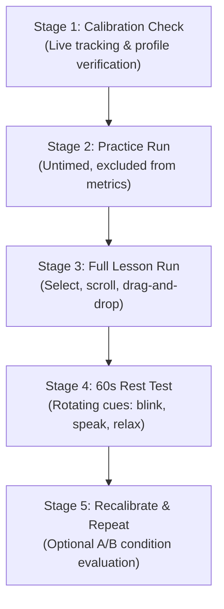

# Evaluation Methodology & Study Protocol

This document outlines the evaluation methodology, metric definitions, guided study protocol, privacy safeguards, and empirical pilot constraints for the **GestureLearn** hands-free classroom control system (Phase 7: Evaluation and Report).

---

## 1. Metric Definitions

All evaluation metrics are computed via pure, deterministic mathematical functions (`computeMetrics`, `aggregateMetrics` in `src/eval/metrics.ts` and `src/eval/stats.ts`) accepting timestamped event arrays and returning structured summaries. No I/O, `Date.now()`, or framework-specific hooks are utilized.

### 1.1 Response Time
Response time measures the latency between when a learner initiates a physical gesture and when the system executes the corresponding command:
$$\text{Response Time} = t_{\text{executed}} - t_{\text{gestureOnset}}$$

- **Median ($p_{50}$)**: Calculated using the **R-7 / NIST standard linear interpolation** between adjacent ranks:
  $$\hat{Q}(p) = x_{(k)} + (h - k)(x_{(k+1)} - x_{(k)})$$
  where $h = (N - 1)p + 1$, $k = \lfloor h \rfloor$.
- **90th Percentile ($p_{90}$)**: Characterizes upper-tail latency using the same R-7 standard formula at $p = 0.90$.
- **Edge cases**: If $N = 0$, both median and $p_{90}$ evaluate to `null` ("no data"). If $N = 1$, both evaluate to the single recorded latency.

### 1.2 Accidental Activations (Activity vs. Rest)
Accidental activations represent unintended command executions:

1. **Activity Mode (`mode: 'activity'`)**:
   - Accidental activations are detected from two distinct sources:
     1. **Learner Undo Actions**: Any command followed by an `undo` event within a 5-second attribution window, or tagged with `undone: true`.
     2. **Facilitator Real-Time Flags**: Commands explicitly flagged as unintended by the facilitator via the Facilitator Bar (`facilitatorMarks`).
   - **Deduplication**: If an accidental command was both undone by the learner and marked by the facilitator, it is counted **exactly once** in `accidental.total`.
   - **Rate per Minute**: Normalized by active session duration:
     $$\text{Accidental Rate} = \frac{\text{accidental.total}}{\text{durationMinutes}}$$

2. **Rest Mode (`mode: 'rest_test'`)**:
   - During the 60-second rest test, any `command_executed` event is classified as a false positive ($N_{\text{false}}$), as the participant was instructed to rest, blink, breathe, or speak naturally without issuing commands.
   - **Rest False Fires per Minute**:
     $$\text{Rest False Fire Rate} = \frac{N_{\text{false}}}{\Delta t_{\text{rest}} / 60000}$$

### 1.3 Task Completion Times
- **Selection / Quiz Tasks**: Duration from the presentation of a question/item to the first `answer_attempt` or successful selection.
- **Drag-and-Drop Tasks**: Duration from the initial label `grab` to the final `label_drop` in the correct target zone.
- **Overall Activity Duration**: Wall-clock time between the first session event and `task_complete`.

### 1.4 Tracking Loss
- Measures tracking robustness under varying lighting, head movements, and camera angles:
  $$\text{Tracking Loss Ratio} = \frac{\sum (t_{\text{restored}} - t_{\text{lost}})}{\text{Total Session Duration}}$$
- Sessions report both total duration (seconds) and count of tracking loss incidents.

---

## 2. Study Protocol

The evaluation protocol guides the facilitator and participant through 5 standardized stages designed to evaluate system efficacy under realistic classroom conditions.



### Stage 1: Calibration Check
- Verify that the camera feed is active and tracking landmarks reliably (100% face/hand tracking quality).
- Confirm the participant's individualized calibrated profile is loaded (`enter` and `exit` thresholds active).

### Stage 2: Practice Run
- An untimed, low-stakes exploration stage where the learner practices selection, scrolling, and dragging.
- Events are tagged with `practice: true` and excluded from primary evaluation metrics to mitigate learning-curve artifacts.

### Stage 3: Full Lesson Run (`mode: 'activity'`)
- The learner completes an interactive lesson covering:
  1. Multiple-choice selection (`select` gesture or dwell).
  2. Content scrolling (`scroll` gesture or edge hover).
  3. Diagram labeling via drag-and-drop (`grab` + cursor movement + `drop`).
- The facilitator observes the session and logs any unintended gesture triggers via the `FacilitatorBar`.

### Stage 4: Rest Test (`mode: 'rest_test'`)
- A 60-second timed quiet period with rotating on-screen cues every 12–15 seconds:
  1. *0–15s*: "Look straight at the screen. Blink naturally and relax."
  2. *15–30s*: "Speak a sentence aloud (e.g., read this prompt aloud)."
  3. *30–45s*: "Slightly shift your seating position or turn your head gently."
  4. *45–60s*: "Breathe naturally and maintain casual resting posture."
- The system samples the control signal at 10 Hz (downsampled) and records any unintended threshold crossings or command fires.

### Stage 5: Recalibrate & Repeat
- Facilitates condition comparison (e.g., *Head Mode* vs. *Hand Mode*, or *Default Preset* vs. *Personalized Calibrated Profile*).
- Enables evaluating pre- vs. post-recalibration deltas in response time and accidental activation rates.

---

## 3. Privacy, Consent & Data Governance

GestureLearn was designed from the ground up for strict privacy in educational environments:

1. **Zero Video Storage or Transmission**:
   - Camera video frames are processed exclusively in browser memory by local MediaPipe WebAssembly workers.
   - Video frames, images, and raw pixel data are **never recorded, written to disk, or transmitted over any network**.
2. **Anonymous Participant Identifiers**:
   - Only anonymous participant codes (e.g., `P1`, `P2`) are used. Real names, student IDs, and personally identifiable information (PII) are prohibited.
3. **Explicit Facilitator & Participant Consent**:
   - A mandatory consent gate must be checked before initiating a study session:
     > *"Participant (or guardian) has consented to hands-free evaluation and signal recording. No video is ever stored."*
   - Dexie IndexedDB records the exact boolean flag and ISO timestamp (`consentGiven: true`, `consentTimestamp: ...`).
4. **Data Portability**:
   - Study sessions, facilitator marks, and aggregate metrics can be exported as structured CSV files or sanitized JSON bundles.
   - Bundles can be imported into another machine or ingested by a FastAPI service for secondary offline verification.

---

## 4. Limitations & Scientific Disclaimers

> [!IMPORTANT]
> **Two-User Pilot Study Disclaimer**:
> Data collected under this evaluation framework represents an exploratory, descriptive two-user pilot study ($N = 2$). Findings are reported as raw empirical observations (medians, percentiles, and percentage deltas). 
> 
> **No inferential statistical claims** (such as $p$-values, ANOVA, or generalized population significance) are made or implied. Results serve solely to demonstrate system feasibility, compare individual baseline differences, and validate the metric pipeline.

### Synthetic Demo Fallback
For demonstration or offline preview purposes without live participants, the Results Dashboard provides a **"Load Demo Data (N=2 Pilot)"** utility.
- All synthetic datasets are prominently marked with a visual badge:
  ```
  [SYNTHETIC DEMO DATA, NOT REAL RESULTS]
  ```
- Metric cards display an amber `SIMULATED` pill.
- Synthetic sessions are strictly tagged with `source: 'replay'` and `participantId: 'DEMO-P1'` / `'DEMO-P2'` to prevent contamination of real study records.
